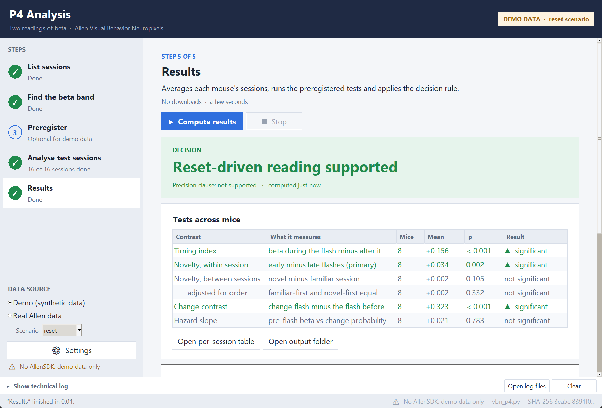
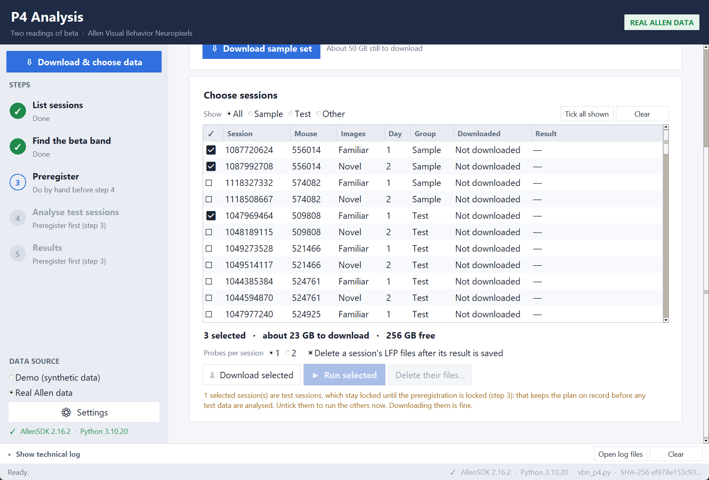
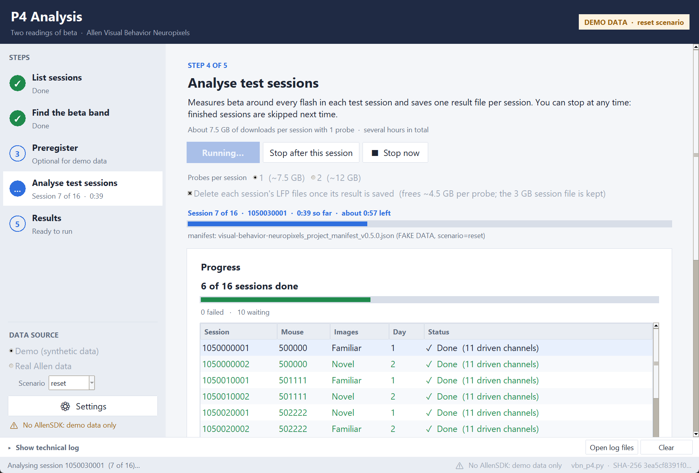

# P4 Analysis

A desktop window for running **`vbn_p4.py`** — the test of prediction P4 (Leven, *Adaptive Resonance and the
Stencils of Spatial Computing*) on the Allen Institute's Visual Behavior Neuropixels data — without typing
command lines. It follows the steps in *Leven_P4_Allen_data_guide.docx*.



**The window never changes the science script.** The preregistration fixes `vbn_p4.py` by its SHA-256 checksum, so
the window runs it exactly as the guide's commands do and only reads the files it writes. (The changes made to the
guide's version, all before any test mouse was analysed, are listed below.)

## Where the real analysis stands

Steps 1 and 2 are done on the real data, and the preregistration bundle is ready. No test mouse has been analysed.

- **Band: 15–30 Hz**, the guide's fallback. The 4 pilot sessions show a theta peak near 7 Hz and a rise into gamma, but
  no clear beta peak, whichever channels are used (42 or all 156 spectra). `p4_out\pilot_check_spectrum.png` shows it.
- **Pilot checks passed on all 4 sessions:** 9–10 of 10 channels driven, both shared images seen, and hazard values
  varied. They are in `p4_out\pilot_check.json`.
- **Next, for Sam:** upload `p4_out\prereg\prereg_bundle_20261104-215408.zip` to OSF, then in step 3 paste the link and
  press **Lock**. Steps 4 and 5 then run in the window (32 sessions, about 7.7 GB each).
- **On another PC or with the installed app:** copy the `p4_out` folder to `%USERPROFILE%\P4 Analysis\p4_out`, so the
  band stays the same one and the 46 GB pilot download isn't needed again.
- The pilot's 46 GB of downloads were deleted afterwards; the session tables were kept. **Download sample set** gets the
  files back.

---

## Install it on Windows

Download **`P4-Analysis-Setup-1.0.0.exe`** from the [latest release](https://github.com/peaktutor/Sam/releases/latest)
and run it. It needs 64-bit Windows 10 or 11, but no administrator rights and nothing else installed first: Python, the
packages and Microsoft's C++ runtime are all bundled. It has been tested on one PC so far, not on a freshly installed
Windows.
Then open **P4 Analysis** from the Start menu or the desktop shortcut.

- The installer is not code-signed, so Windows SmartScreen may say "Windows protected your PC". Choose **More info**,
  then **Run anyway**.
- Downloads and results go to the **`P4 Analysis`** folder in your user folder (`%USERPROFILE%\P4 Analysis`), which
  you can change in **Settings**. Uninstalling removes the program and leaves that folder alone.

The window opens on **demo data** the first time, so every step can be tried in about a minute without
downloading anything. Switch to **Real Allen data** in the sidebar when ready.

## Download and choose data

**⇩ Download & choose data**, at the top of the sidebar, opens the Data page:



- **Download sample set** fetches the 4 sessions of the 2 pilot mice, with 2 probes each (about 50 GB: about 2 hours at
  7 MB/s, about 14 hours at 1 MB/s).
  If the session list isn't there yet, it gets that first. Step 2 uses the same files, so it won't download them again.
- **Choose sessions** lists every session in the dataset. Click rows to tick them, then **Download selected**,
  **Run selected**, or **Delete their files**. The line above the buttons shows how much that adds up to against
  your free space.
- Results of sample and other non-test sessions go to `p4_out\sample_runs`, and never count in step 5.
- Test sessions you run here go in with the test results. With real data they stay locked until the preregistration
  is locked; you can download them before that, but not analyse them.
- Running needs a beta band, so finish step 2 first.

## Run it from source

Double-click **`run_p4_app.bat`**. Or, from a terminal in this folder:

```
.venv-vbn\Scripts\python -m p4_app          (real data; this environment has AllenSDK)
.venv-test\Scripts\python -m p4_app --demo  (synthetic demo data only)
```

### Setting up for real data from source

Real data need Python 3.10 with AllenSDK 2.16.2 (the version the script was checked against). With
[uv](https://docs.astral.sh/uv/), from this folder:

```
uv python install 3.10
uv venv .venv-vbn --python 3.10
uv pip install --python .venv-vbn\Scripts\python.exe allensdk==2.16.2 hdmf==3.14.6 scipy xarray
```

**Keep `hdmf==3.14.6`.** AllenSDK 2.16.2 does not pin `pynwb` or `hdmf`, and an installer left to itself picks
`hdmf` 6.x, with which the session files fail to open (`Can't instantiate abstract class NWBFile`). The Settings
page warns if it finds that combination.

The window finds `.venv-vbn` by itself (a conda environment called `vbn` works too). **Settings** shows which
Python it uses and whether AllenSDK is there; with real data, nothing runs until it is.

**Disk space:** the pilot needs about 50 GB. Each test session downloads about 7.7 GB (1 probe) and keeps 3 GB
with *Delete each session's LFP files* on (the default). With the real data there are **32** test sessions, so the whole
run downloads about 250 GB and keeps about 100 GB with clean-up. **Settings** shows
the estimate against the free space on the drive you choose for the download cache.

## The five steps

| Step | What happens | Downloads |
|---|---|---|
| **1 List sessions** | Session tables; splits the mice into 2 pilot mice and the test mice | ~160 MB |
| **2 Find the beta band** | Beta peak in visual-cortex spectra of the pilot mice only; band = peak ± 5 Hz | ~50 GB |
| **3 Preregister** | *Export bundle* → upload to OSF → paste the link → *Lock* | none |
| **4 Analyse test sessions** | One session at a time; results saved per session; stop and resume any time | ~7.5 GB per session |
| **5 Results** | Per-mouse tests and the preregistered decision | none |



### Safety features

- **Preregistration lock.** Locking records the checksums of `vbn_p4.py`, `band.json` and `split.json`. If any
  of them changes afterwards, the window shows a red banner and, with real data, blocks steps 4 and 5. With
  real data, step 4 cannot start before the lock exists.
- **One session at a time.** Step 4 runs `vbn_p4.py analyze --session ID` per session, so between sessions it
  can delete that session's LFP files (only `probe_*_lfp.nwb` in that session's own cache folder, only after
  its result exists without an error), check free disk space (it pauses rather than fill the drive), and stop
  cleanly (**Stop after this session**). A session interrupted by **Stop now** simply runs again next time.
- **Demo data never mix with real data.** Demo runs write to `demo_run\` only.
- **Every run is logged** to `p4_out\logs\`, with the command line and the script's checksum.

## How the script differs from the guide's Appendix A

Sam asked for the guide to be followed, with judgement where it is silent. The docx version is kept as
`vbn_p4_original.py`, and the preregistration bundle lists every change. All were made on the pilot mice, before any
test mouse was analysed.

- **Crashes on the real files, fixed:** the channel table's column is `ecephys_probe_id`, and the Welch window is
  rounded, because probe clocks differ slightly from 1250 Hz.
- **To match the guide:** 16 test mice (the first after the pilot mice in the seeded shuffle; the script had taken
  47). "Every second channel" is of those the LFP file holds, since real files keep every 4th. A spectrum still rising
  at the edge of 12–40 Hz is not a peak, so the guide's 15–30 Hz fallback applies: the real pilot spectrum has a theta
  peak near 7 Hz and a rise into gamma, but no beta peak. Reversals of a predicted sign are reported, and the two shared
  images give a control contrast.
- **Judgement:** in the hazard estimate, a change flash counts as one more than the flash before it, because AllenSDK
  numbers every change flash 0.

## Long runs

- The window keeps the PC awake while something runs. On a laptop, keep it plugged in with the lid open.
- AllenSDK treats any existing file as complete, so a stopped download can leave a cut-off file that looks finished.
  The window checks files against the manifest's hash before using them, and retries dropped connections. **If you run
  `vbn_p4.py` by hand, run `tools\download_sessions.py` first** for the same protection.
- Files download over 8 connections at once, because Amazon limits each connection (on a slow line this measured 0.28
  MB/s with one and 1 MB/s with 8). A stopped download carries on from the pieces it has, kept as `NAME.nwb.part` beside
  the file until it passes the hash check. Delete the session's files on the Data page to clear them.

## Not covered

**P4(b), the hippocampal arm**, uses CRCNS hc-11 and needs a free CRCNS account. Its public pages mention LFP but do not
confirm the released files include it, so that still has to be checked, as the guide says.

## Where things are

```
vbn_p4.py              the science script (changes from the docx listed above; checksummed)
vbn_p4_original.py     the script exactly as in the docx
tools\pilot_check.py   checks on the pilot sessions (step 2's files)
tools\download_sessions.py  downloads over several connections, checks hashes, resumes
run_p4_app.bat         double-click to start
p4_app\                the window
  gui.py               layout, pages, actions
  runner.py            runs one vbn_p4.py step as a subprocess, streams its output
  session_queue.py     step 4, one session at a time
  storage.py           finds and deletes downloaded files
  prereg.py            preregistration bundle, lock and checksum guard
  settings.py          app_settings.json, the Python check, disk space
  state.py             reads vbn_p4.py's output files for the pages
  plots.py             the charts
tests\                 automated tests (below)
  fake_allensdk\       a stand-in for AllenSDK that produces synthetic data
PLAN.md                the programming plan and its status
```

## Build the installer

```
python build\build_installer.py
python build\test_installed.py --real
```

The first builds `dist\P4-Analysis-Setup-<version>.exe` (needs `uv`, Inno Setup 6 and Microsoft's Visual C++ runtime 14.44
or newer, which it copies from this PC). It bundles a portable Python 3.10 with the exact package versions in
`build\requirements-lock.txt`, and a small launcher, `P4 Analysis.exe`. The second installs it into a temporary folder and
tests it there: the C++ runtime loads from the bundle, the launcher opens the window, the whole demo flow runs, one
real session is downloaded and analysed (about 8 GB, deleted afterwards; leave out `--real` to skip it), and it
uninstalls cleanly.

The bundle includes AllenSDK, whose license forbids redistributing it commercially without the Allen Institute's
permission. Its notice is in `third_party_licenses\`.

## Tests

```
.venv-test\Scripts\python -m pytest tests -v
```

About 10 minutes. The pipeline tests run the **unchanged** `vbn_p4.py` end to end on synthetic data from
`tests\fake_allensdk` (planted reset-like, rebound-like and null signals) and check that the decision rule
recovers each one; the app tests cover the runner, settings, step 4's queue and clean-up, the preregistration
lock, and the charts. The suite passes
in both `.venv-test` (Python 3.13) and `.venv-vbn` (Python 3.10 with AllenSDK 2.16.2; four checks that need a
Python without AllenSDK skip there).
